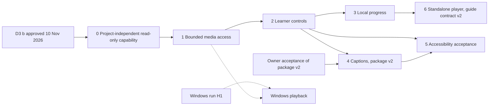

# Offline learner player — implementation and dependency plan (10 November 2026)

**Status:** plan only. No code exists for anything below. Written by the Opus session as sole
writer. Each slice starts only after the coordinator gate.

**Updates, 10 November 2026:**
- **D3 decided.** The owner approved D3(b) for read-only inspection and playback only (see the
  roadmap decision table). Slice 0's dependency is met; its implementation still waits for the
  coordinator gate.
- **Review lows P1 and P2.** The [independent review](OPUS_INDEPENDENT_REVIEW_2026-11-10.md)
  raised these against slices 0 and 1, and they are folded in below.
- **Lifetime pattern.** The R1/R2 fix (`0c73895b`) sets the pattern every player capability
  must follow.

**Goal:** a learner opens a verified portable lesson package and works through it one step at
a time, fully offline: watch the step's video, pause, replay, change speed, read the
instructions and code, move to the next step, and keep their place.

## Fixed constraints

These do not change in any slice below:

- **Media contracts.** The accepted contracts stay as they are: MP4 only, 1280 px cap, 30 fps,
  120 s per step video, at most 4 videos and 32 steps per package, and no GIF or standalone PNG
  outputs. The player plays what package v1 already contains.
- **Package v1.** The format (`openscreen-portable-lesson` v1) and the guide contract
  (`openscreen-static-guide-portable-v1`) stay byte-compatible. The player never writes into a
  package.
- **Windows gates.** They are not loosened. The verifier is Linux-only today (H1), so the
  player is too, until a Windows run is accepted separately.
- **No automatic writes of lesson work.** Automatic recovery waits for the owner (D1), and the
  manual-recovery promise stays. Learner progress (slice 3) is a separate, explicit store,
  never authoring recovery.
- **Offline.** No network, account, CDN, server, analytics or telemetry.

## Why the player runs in the app first

A player script inside the package's own `index.html` would break the v1 guide contract.
That page is deliberately script-free, with CSP `default-src 'none'`, and its bytes are pinned
by the committed fixture. A script-bearing guide therefore needs a new contract version, and
`file://` media and storage rules differ across browsers. The app already holds the strict v1
verifier.

So the first player is a separate, locked-down player window in OpenScreen. A standalone
in-package player is listed as slice 6. It needs its own owner decision and a v2 guide
contract.

## Slices, in dependency order

### Slice 0 — package capability that does not depend on the video project (prerequisite; M)

**Depends on:** owner decision D3, option (b): **approved 10 November 2026**, for read-only
inspection and playback only.

Today a package capability requires a selected, saved, clean video project (M2). A learner has
no project, so the player needs a capability that is:

- **Explicit:** created only by a native folder picker in a dedicated `lesson:player-open`
  route. There is no path from the renderer, no discovery and no recent-files list.
- **Strictly verified:** the existing `inspectLessonPackage` runs with full decode. The
  open-time inventory, manifest hash and per-file identities (device, inode, size, mtime,
  ctime) are pinned.
- **Owner-bound:**
  - It belongs to the asking player window's `webContents`.
  - It ends on navigation, renderer crash, destroy or explicit release.
  - Each window holds one capability, and a new open replaces the old one.
  - It does not depend on project selection or dirty state.
- **Read-only and narrow:** it allows playback and reading the lesson only. Reseal, copy and
  create keep their current project-bound capability unchanged.
- **Lifetime, following the R1/R2 fix:**
  - The owner's state and its navigation, crash and close listeners exist before the picker is
    awaited.
  - Each open pins an epoch and an operation generation.
  - The open rechecks owner, page, epoch and generation after the picker, after verification,
    and before installing the capability or returning.
  - A stale or superseded open verifies nothing further and grants nothing. An older open can
    neither replace nor revoke a newer one.

**Tests:**
- Refusal for a foreign window, a subframe, navigation, crash, a stale token, symlinks and
  unlisted files.
- Navigation, crash or close while the picker or the verification is pending. Overlapping opens.
- A real-app probe that opens a package with no project selected.

**Mutation controls:** owner check, lifetime events, and that the read-only scope gives no
reseal or create access.

### Slice 1 — bounded media access (L)

**Depends on:** slice 0.

The `<video>` element needs bytes without `file://` access and without widening
`webSecurity`. The design:

- **One exclusive session per player owner (review Low P1).**
  - Each player window gets its own unique, ephemeral, in-memory partition, such as
    `lesson-player-<random uuid>`, never a shared fixed name. It uses sandbox,
    `contextIsolation`, no Node integration and `webSecurity` on.
  - Exclusivity is enforced, not assumed:
    - no other window or `webContents` is ever created on that partition;
    - `will-attach-webview` and subframe creation are refused;
    - `setWindowOpenHandler` denies every `window.open`;
    - `will-navigate` and `will-redirect` refuse anything but the player's own page.
  - The partition and its protocol handler are torn down when the owner ends.
  - Tests cover a second player window (its own partition, unable to fetch the first one's
    media) as well as an editor and the HUD.
  - CSP: `default-src 'none'; script-src 'self'; style-src 'self'; img-src data:;
    media-src openscreen-lesson-media:`.
- **A privileged scheme registered only on that session.**
  - `openscreen-lesson-media://<capability>/<stepId>` is registered with
    `session.protocol.handle` on the player partition alone, so no editor, HUD or other window
    can resolve it at all.
  - Electron's protocol handler does not name the requesting frame. The binding therefore
    comes from the partition plus the unguessable capability ID, checked against a live owner.
- **What the handler serves:**
  - Only `media/<stepId>.mp4` entries in the verified manifest, and only while the
    capability's owner is alive.
  - Each request reads one bounded buffer, never a stream over a live file (review Low P2):
    1. open with `O_NOFOLLOW` and compare `fstat` with the open-time pins;
    2. read the requested range, at most 8 MiB, into memory;
    3. compare `fstat` again and confirm the capability is still current, immediately before
       returning the bytes;
    4. close the descriptor.

    Any difference, or an in-place change seen at step 3, ends the capability and returns no
    bytes. The full hash runs at open, not per range.
  - One byte range per request. `206` and `416` follow the spec, with `Content-Type: video/mp4`
    and no directory listing.
  - **Aggregate budget:** at most 2 requests in flight per capability, and at most 32 MiB
    buffered across all player owners. Requests beyond either limit wait in a bounded queue or
    are refused with `503`, and are never buffered without limit.
  - **Revocation cancels:** release, navigation, crash or close aborts queued requests, closes
    open descriptors and discards buffers. No pending range completes after revocation.
  - Everything else gets a fixed 404 with no path in the body.
- **No other route.** The player never receives filesystem paths. Images stay as data URLs
  from the verified lesson JSON.

**Tests:**
- Handler unit tests: token, owner, inventory membership, range parsing and bounds, identity
  change, symlink swap.
- The file mutated in place during a read (same inode, changed bytes or size), which must
  return no bytes.
- Navigation or release while a range is pending, which must abort it and close its descriptor.
- The per-capability and global concurrency and byte limits.
- A real-app probe: a `<video>` element plays and `currentTime` advances. A tampered or
  replaced MP4 after open is refused. A second window cannot fetch.

**Required checks:** the real headless startup smoke, because handler registration changes.

### Slice 2 — learner controls (M)

**Depends on:** slice 1.

- **One step at a time.** Each packaged MP4 is already exactly one step, so "segment
  auto-pause" means stopping at the end of the step's video.
- **Controls:** Play/Pause, Replay, Loop, speed from 0.5× to 1.5×, and Previous/Next step.
  The step's instructions, code (as text, copyable) and image with alt text sit alongside.
  Steps without video show text only.
- **Keyboard:**
  - Space plays or pauses; R replays; L loops; `[` and `]` change speed.
  - Alt+← and Alt+→ change step.
  - Every control is also a named button.
- **Audio** plays as encoded but is labelled "audio not checked", because receipts keep audio
  flags false.

**Tests:** component tests for every control and key, plus a real-app probe driving them.

### Slice 3 — local progress (S/M)

**Depends on:** slice 2.

- **When it saves:** progress is written only when the learner presses "Mark step done". That
  keeps the explicit-write rule.
- **What it saves:** keyed by lesson ID plus manifest SHA-256, a set of done step IDs and the
  last step. No timings, no identity.
- **Where it lives:** main writes a small bounded JSON file under `userData/lesson-progress/`,
  with a strict schema, a size cap, atomic replace and 0600 mode.
- **Failure and reset:** if storage fails, the learner can still play; the player shows a
  notice. "Forget my progress for this lesson" deletes the entry.

**Tests:** schema, caps, denial, reset; a changed package (new manifest hash) starts fresh.

### Slice 4 — captions (M/L; needs a new package contract version)

**Depends on:** slice 2 and owner acceptance of a package v2 contract.

- **Package format.** Package v1 has no caption files. Captions need optional, inventory-listed
  `captions/<stepId>.vtt` entries under a new manifest version. v1 packages keep verifying and
  playing without captions.
- **Source.** Existing local Whisper transcripts and caption edits, cut to each step's
  confirmed range. The author reviews them before they are included.
- **Player.** `<track>` elements with on/off and size controls, reusing the existing caption
  font and theme settings.

**Tests:** v1 compatibility fixture unchanged, v2 inventory and bounds, WebVTT sanitising, and
a real-app probe with captions shown.

### Slice 5 — accessibility acceptance (M, with a person)

**Depends on:** slices 2 to 4.

- **Automated:**
  - Keyboard-only paths and visible focus.
  - Step-named buttons, following the `5a2b0f14` pattern.
  - `prefers-reduced-motion` and the existing Standard, Large print and High contrast
    profiles.
  - An automated accessibility check in the real-app probe.
- **Manual:** a screen-reader session (Orca on Linux) and a keyboard-only session by a person.
  These cannot be replaced by CDP evidence.

### Slice 6 — standalone in-package player (later; owner decision)

This is for learners without OpenScreen. It needs a new guide contract version with a
script-bearing page, `media-src 'self'`, and trials across browsers over `file://`.
v1 verification stays unchanged. Decide after slices 1 to 3 are in use.

## Dependency graph

## Risks

- **Codecs.** Electron's Chromium must decode the packaged H.264. The verifier already decodes
  with the shipped FFmpeg, and the player does not.
- **Range bounds.** Chromium may request large ranges; the 8 MiB bound must be measured
  against smooth seeking.
- **Binding without the frame.** Protocol requests do not identify the frame. The unique
  per-owner partition is the binding, and slice 1 enforces that no other window, webview,
  subframe or navigation can share it.
- **Linux only.** Windows and macOS learners cannot use the player until H1 is resolved.

## Validation for every slice

- Pinned Node 22.22.1 and npm 10.9.4.
- Focused tests, both `tsc` configurations, lint and i18n.
- A Vite build.
- The required foreign-directory startup smoke whenever handlers change.
- A full suite at milestones.
- A real-app probe with stubbed dialogs.
- Each slice reports itself as self-tested until independently reviewed.
