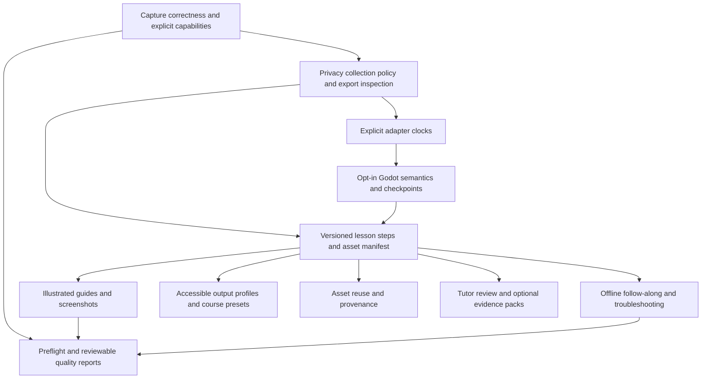

# OpenScreen Lesson Capture product map

Updated 6 November 2026 (review22 accepts runtime video validation at91b59b1d; guard/provenance follow-up awaits review). **Record once. Produce multiple editable teaching resources.**
This is the expanded fork backlog, not an upstream release announcement. Entry point:
[current roadmap](../LESSON_CAPTURE_ROADMAP.md). Architecture and audit:
[ARCHITECTURE.md](ARCHITECTURE.md), [CURRENT_STATE_AUDIT.md](CURRENT_STATE_AUDIT.md).
The [original specification](project-spec.md) remains authoritative for existing
rolling-buffer, step replacement, lesson/slide mapping, checkpoints and handoff requirements.
This map adds requirements; it does not replace those workflows.

**Core requirement:** ordinary capture, editing and outputs must work with every
adapter disabled and Godot absent. Use the three levels and
[optional capability architecture](APPLICATION_INTEGRATIONS.md). Godot is the first
deep adapter; Blockbench, Unity, Unreal Engine, MCreator, Roblox Studio and other
desktop/web tools are generic capture subjects. No other adapters are requested now.

## Status and evidence rules

**Implemented** means code exists for the stated bounded capability; it does not
mean physical or release acceptance. **Partial** means some reusable delivery
exists but the full requirement is unmet. **Planned** means no integrated capability
was established by this audit. **Experimental** means an opt-in prototype or driver
with explicit capability/acceptance limits. Each implementation must link a dated
SHA, test evidence and skips. Documentation alone proves none of these behaviors.

Complexity is relative: S = bounded existing-path extension; M = multiple modules;
L = integrated UI/data/export work; XL = platform or cross-cutting lifecycle work.
These are planning estimates, not time commitments. Items can ship independently
when dependencies and privacy requirements are satisfied; phases are not release gates.

## Feature-status matrix

| Feature | Current bounded status | Delivered foundation and remaining limit | Delivery order |
| --- | --- | --- | --- |
| Universal core / optional integration manager | Partial | Core media independent; selected-file integration controls and explicit read-only Godot clock bridge; deeper adapter capabilities remain | Foundation before deeper adapters; settings planned |
| C Privacy-safe capture, storage and export | Partial | Default-off Linux button gates, scope suppression, source-bound receipts/recovery exclusions; full redaction/allowlists remain | Critical, phase 0; broad capture gate |
| A Illustrated lesson guides | [Partial first slice](../LESSON_CAPTURE_GUIDES.md) | Manual steps, neutral flag/typing drafts, native stills, editable source, selected HTML/Markdown and bounded print proof; semantic generation remains | Very high, phase 1 |
| B Godot semantic recording | Partial | Opt-in actual unsaved CodeEdit capture; no semantic scene adapter | Very high, phase 2 after privacy/clock contracts |
| D Offline interactive lessons | Partial prerequisites; timed player planned | Static keyboard navigation/print and authored range references; no timed controls/progress | High, phase 3 |
| E Accessible differentiated outputs | Partial | Unified lesson Standard/Large print/High contrast, language/direction and image/code exclusions; reviewed simplification/narration/slow profiles remain | High, phase 1 defaults + phase 3 delivery |
| F Recording script/checklist | Planned | Notes and flags; no source-linked recording checklist established | Medium-high, phase 4; small earlier slice allowed |
| G Quality review | Partial | Probes/health plus source review labels/findings and bounded title/status/source queries; unified media QC remains | High, preflight now; unified report phase 4 |
| H Teaching-asset library | Planned | Project assets/relinking, typing bundles, local appearance presets | Medium-high, phase 4 |
| I Tutor review/approval | Partial source labels; tutor workflow planned | Draft/reviewed step labels and findings; no multi-user approval/comments/audit workflow | Medium, phase 5 |
| J Assessment evidence packs | Planned | Source provenance and original lesson mapping requirements | Future/experimental, phase 5 |
| K Troubleshooting branches | Planned | No linked step graph/player yet | Medium, phase 3 |
| Automatic step renumbering | Partial | Stable lesson step IDs, reorder/selection and derived consecutive guide numbering; legacy annotation labels remain manual | S/M, phase 1 |
| Object-attached arrows | Partial | Editable normalized connector geometry, no object bindings | M, phase 1/4 |
| Idle-cut suggestions | Planned | Existing trims/speed edits and transcript/cursor signals | M, phase 4 |
| Portable course visual presets | Partial | Existing style-preset service and arrow styles | M, phase 1 |
| Recording preflight | Partial | Platform/helper checks and live journal health | M, phase 0 |
| Export manifest integrity | Partial | Validated static lesson assets/projection and hash receipts; range backend adds bounded Linux stored-sample timing/full video decode receipts; full editor/media/course packaging remains incomplete | L, phase 1 prerequisite |
| Rolling buffer/save recent | Planned | Full recording, clips and source ranges | L/XL, preserved phase 0 reliability work |
| Retakes/checkpoints/handoff | Partial | Existing editor checkpoints/CLI/MCP; no complete lesson retake workflow | L, phases 1–2/acceptance |

## Dependency plan and next work

Current delivery: [guides](../LESSON_CAPTURE_GUIDES.md),
[commands](../LESSON_CAPTURE_COMMANDS.md), [clock bridge](../LESSON_CAPTURE_CLOCK_BRIDGE.md)
and [authored ranges](../LESSON_CAPTURE_RANGES.md) have bounded implementations.
Actual reviews through18 accept their exact SHAs; original reports retain limits.
The expanded requirement descriptions below remain future acceptance targets, not
claims that every listed operation exists.

1. Current selected-media materialization/revalidation backend and encoded proof
   are accepted within their bounds at125ec5de by actual review20 (M22-1 closed). Slice22 is a backend building block, not a GUI,
   CLI or player release. Its first native MP4 proof found a video-stream duration
   discrepancy; do not claim timed-playback readiness from native stats alone.
2. The user explicitly resumed after restart. [B22-2 Linux native video timing](../LESSON_CAPTURE_NATIVE_VIDEO_TIMING.md)
   fixes the unknown final-sample duration with bounded rebuilt-addon proof. Actual
   [review21](CLAUDE_POST_RESTART_REVIEW_21.md) accepts2c29d268 with no High/Medium
   for Linux software synthetic/offscreen encoding. LowL23-W1 tracks unchanged
   macOS/Windows drains. Preserve all earlier artifacts.
3. [Slice24 runtime video validation](../LESSON_CAPTURE_ENCODED_VIDEO_VALIDATION.md)
   checks stored MP4 video samples and actual decoded frames with shipped FFmpeg,
   under bounded Linux-only limits; actual [review22](CLAUDE_POST_RESTART_REVIEW_22.md)
   accepts91b59b1d with no High/Medium. Its
   [guard/provenance follow-up](CLAUDE_POST_RESTART_FOLLOWUP_22.md) is accepted at361fde51
   by actual [review23](CLAUDE_POST_RESTART_REVIEW_23.md), no High/Medium.
   LowL25-1 descendant-pipe settlement and T25-1 provenance tests accompany the
   next source-identity slice. Historical
   authored source identity/availability and remaining guard coverage still precede
   user-facing materialization with cancellation and authority controls. Timed Next/Previous/Replay/
   loop/speed, captions and local progress remain unimplemented.
4. Continue remaining privacy/redaction, continuous optional clock/edit projection,
   rolling buffer, retakes/handoff and physical/platform acceptance separately.
   Source clocks/claims stay distinguishable; imported references must be revalidated.
5. Preserve the full dependency backlog below: automatic semantic guide generation,
   course mapping/slide/outcome references, differentiated authored alternatives,
   troubleshooting, QC, library, tutor review and optional evidence packs remain.

## Phase 0 — capture correctness, privacy and reliability

### P0.1 Input/media fidelity and platform acceptance — Partial; now; XL

- **Purpose/reuse:** trustworthy navigation from evidence to footage; reuse native
  `CaptureClock`, append-only journal, flags, session health and source projection.
- **Approach/dependencies:** finish reader-time projection/cursor consistency,
  bounded stop draining and explicit device gaps; preserve interval/sequence
  semantics. Bridge Godot clocks explicitly after privacy controls. Complete
  Windows driver and KDE physical mouse/tap/scroll, dialog/geometry support only
  with truthful per-driver capability reporting. No synthetic recovery edges.
- **Risks:** kernel/reader delay, frame staging vs screen time, global driver scope,
  portal/permission differences, IME and device loss. Reader time is not physical time.
- **Accept/test:** counted start/pause/resume/stop/held-button/device-loss scenarios;
  timing bounds on actual footage; synthetic clocks/queues plus native encoder
  tests, rebuilt binary hashes and real Windows/KDE runs. Missing platforms remain
  skipped, not inferred from shared source. See existing input implementation docs.

### P0.2 C — privacy-safe capture and lifecycle — Partial; critical/now; XL

- **Purpose/reuse:** protect educators/learners before collecting richer evidence;
  build on explicit pad/Godot opt-in, bounded data and visible driver health.
- **Approach:** versioned capture policy, application/window allowlists, sensitive
  app/field exclusions, immediate input suppression control/status, explicit
  warning outside authorized scope. Apply policy before reading/persisting text
  or events where possible; never rely on password detection. Unknown scope must
  be explicit, with restricted capture suppressed. Video capture and input scope
  are separate capabilities. Broader collection cannot ship behind a misleading badge.
- **Retention/export:** independently exclude retained evidence intervals and derive
  redacted exports covering raw journals, typing baselines/deltas, code, caches,
  thumbnails, guides and packaged assets, as well as frames/audio/captions. Preserve
  originals by default; actual sensitive-source deletion requires explicit user
  action and must describe residual copies. Redaction needs a valid new baseline,
  not deleted deltas that make later content leak or fail reconstruction.
- **Dependencies/risks:** inventory every writer/consumer; platform identity APIs
  vary; hidden metadata/logs and backups can leak; display blur does not erase raw
  content. Local processing, no telemetry/cloud upload/third-party AI by default;
  explicit destination/data consent for configured AI. Audit inherited network
  defaults and model downloads rather than assuming offline behavior.
- **Accept/test:** private canaries absent from all retained/exported paths after
  suppression, pause/focus changes, restart/crash, denied/unknown scope and malicious
  imports. Pre-export inspection lists coverage, unreviewed sensitive candidates
  and all included evidence; no promise that automatic detection is complete.
  Unit policy/replay tests, actual disk/cache/package scans, UI status/keyboard
  tests and Windows/KDE focus tests. First bounded slice must declare remaining gaps.

### P0.3 Recording preflight and recovery — Partial; now/incremental; M–XL

- **Purpose/reuse:** explain readiness before a lesson; reuse native probes,
  source/device selection, journal health, existing error and permission handling.
- **Approach/dependencies:** one service/report for disk space, chosen source,
  mic/system audio, helper/driver readiness, adapter connection and permissions.
  Distinguish optional warnings from blockers. Probe only requested capabilities;
  ready-at-preflight does not guarantee runtime health. Retain recoverable segments
  and interrupted journals; report an uncommitted tail.
- **Risks:** permissions may prompt, available disk changes, devices disappear.
- **Accept/test:** low disk, absent mic, unavailable helper/adapter, denial and
  mid-record failure produce actionable truthful states in UI and CLI/MCP.
  Mock fault injection plus native unplug/storage trials; no silent success.

### P0.4 Rolling buffer and save-recent — Planned; later after reliability; L/XL

- **Purpose/reuse:** preserve recent useful demonstrations with minimal friction;
  reuse full-session capture, source ranges and event clocks from original spec.
- **Approach/dependencies:** first full-session range marker; then bounded segmented
  ring with event windows and durable commit acknowledgment. Configure storage and
  privacy retention together. Saved range must keep source-time offsets.
- **Risks:** evicted media still referenced; crash during commit; disk pressure.
- **Accept/test:** save/reopen recent footage and matching events across pause,
  segment rotation/restart and eviction; acknowledge only durable media. Test real
  native recording, bounded storage and interruption, not just range arithmetic.

## Phase 1 — common lesson structure and illustrated resources

### P1.1 Shared lesson steps, mappings and editable packages — Partial; bounded source/guide contract delivered; L

**Delivered:** stable versioned lesson/step IDs, editable save/reopen, selected
image dependencies, lineage, explicit manual recovery copies and authored saved-
project range references (slice21). Source plans are not packaged video. Full
merge/split, course/slide/outcome/checkpoint mappings and full media packages remain.

- **Purpose/reuse:** one set of editable steps for every output; reuse source flags,
  typing IDs, annotations, source timeline, media relinker and editor persistence.
- **Approach/dependencies:** separate versioned lesson manifest with stable lesson,
  step, source-event/session/media and asset IDs; adapter for current `.openscreen`
  schema, not a duplicate editor document. Store authored order/label, source
  frame/ranges, lesson/slide/outcome/checkpoint references and observed/inferred/
  authored provenance. Original evidence remains immutable. Preserve unknown
  optional extension data or explicitly reject lossy roundtrips.
- **Risks:** cut/speed/duplicate occurrence ambiguity, missing sources, schema drift.
- **Accept/test:** insert/delete/merge/split/reorder/exclude and reopen steps without
  altering original footage/events; deterministic source mapping and ID semantics
  through revisions. Unit transforms, real disk roundtrips, legacy migration and
  Windows/Linux path tests. Human and agent call the same service.

### P1.2 A — illustrated guides — Partial manual delivery; automatic generation planned; L

**Delivered:** manual editable steps and neutral metadata-only flag/typing drafts,
explicit native composed stills, selected HTML/Markdown/manifest/asset outputs,
script-free navigation and bounded offline print/PDF proof. **Outstanding:**
automatic evidenced screenshot/candidate selection, semantic descriptions, step
grouping and the disposable Enemy automatic-guide acceptance sequence.

- **Purpose/reuse:** reduce screenshot/tutorial assembly; reuse flags, clicks,
  typing, annotations, captions/context and native screenshot/render facilities.
- **Approach:** deterministic candidates around explicit cues and supported events;
  suggest stable screenshot positions and editable numbered groups. Show evidence
  behind each suggested description, shortcut/code/click and screenshot. A click
  alone cannot prove a node was created. Unknown actions get neutral wording/manual
  review. Optional explicitly configured AI drafts retain provenance and require
  review; deterministic offline generation must remain useful.
- **Presentation/export:** original vs clean teaching projections retain evidence;
  reuse vector arrows/highlights. Support insertion/deletion/merge/split/reorder;
  produce HTML, Markdown + relative image assets and offline PDF/print output,
  preserving editable manifest and source links. PDF is not claimed from HTML alone.
- **Risks/dependencies:** meaningful frame choice, unsafe imported text/HTML/assets,
  missing evidence, fonts/print pagination; privacy inspection and manifest integrity.
- **Accept/test:** disposable Enemy sequence yields reviewable steps/screenshots
  for evidenced actions, no invented semantic instructions, editable save/reopen
  and working HTML/Markdown/PDF with assets offline. Unit suggestions, malicious
  markup tests, frame extraction, exporter golden/structure checks, real native
  screenshots and print/PDF inspection. Human tutor can correct every suggestion.

### P1.3 Automatic step renumbering — Partial; early independent slice; S/M

**Delivered:** lesson-step numbering follows stable source order and selected
output order after reorder/exclusion. Linking legacy numbered annotations to that
model and broad undo/mapping acceptance remain; arbitrary authored text is not rewritten.

- **Purpose/reuse:** keep teaching numbers consistent; extend existing numbered
  text boxes and stable step order, not pattern-based rewriting of arbitrary text.
- **Approach/dependencies:** explicit auto/manual numbering mode referencing step
  IDs; derived numbering for auto boxes, preserve manual text; P1.1 owns ordering.
- **Risks:** old numbered text is ambiguous; leave legacy annotations manual.
- **Accept/test:** insert/delete/reorder/reopen/undo updates only auto numbers;
  manual labels unchanged; model, persistence, preview/export and keyboard tests.

### P1.4 Export manifest integrity and portability — Partial; early prerequisite; L

**Delivered:** strict bounded source/image validation, dependency-minimal static
projection and SHA256 readback receipts. Authored range plans retain source pins,
not playable media. Reviews20/21 accept the bounded backend and Linux native
timing; review22 accepts slice24 runtime sample/decode proof at91b59b1d. Its
guard/provenance follow-up awaits review. Historical authored
source identity, full editor/course packaging and timed output acceptance remain.

- **Purpose/reuse:** a lesson opens elsewhere with every dependency; reuse current
  schema validation/relinker and legacy pack, acknowledging current-editor pack gap.
- **Approach:** enumerate transitive video/audio/still/code/annotation/font/preset/
  branch resources, relative safe paths, content checksums and producer/version;
  validate manifests before/after packaging. Missing/moved assets get repair choices.
  Never silently flatten unsupported editor state or package excluded private data.
- **Dependencies/risks:** P1.1 asset references and privacy policy; traversal,
  symlinks, case collisions, huge media and partial copies. New package format is
  additive; do not destructively migrate `.openscreen`.
- **Accept/test:** export, checksum verify and reopen on Windows/Linux; missing,
  changed, malicious and duplicate-path assets fail usefully; interruption leaves
  identifiable incomplete output. Actual disk/package tests plus native render of
  reopened project. CI fixture portability does not replace cross-OS runtime.

### P1.5 Course visual presets — Partial; incremental; M

- **Purpose/reuse:** consistent professional lessons; extend existing style-preset
  service, arrow appearances, captions/code/cursor/export controls.
- **Approach/dependencies:** portable versioned course profile with per-lesson
  overrides, embedded assets/licenses, explicit application and no evidence edits.
  Coordinate with E profiles; one settings vocabulary, not two preset systems.
- **Risks:** missing fonts/cursor overrides and upstream style schema changes.
- **Accept/test:** transfer profile, apply to two lessons, reopen, retain overrides
  and source data; export parity and fallback warnings. Schema/migration, UI and
  package tests, native samples for fonts/cursor/captions.

## Phase 2 — application intelligence and reliable replacement

### P2.1 B — opt-in Godot semantic adapter — Partial; very high/after privacy + clocks; XL

- **Purpose/reuse:** explain demonstrated editor actions; extend current opt-in
  plugin/CodeEdit adapter and versioned event journal rather than global hooks.
- **Architecture gate:** [generic capabilities and integration settings](APPLICATION_INTEGRATIONS.md)
  precede expansion. All adapters disabled/missing/crashing leave ordinary capture,
  generic guides and stored-project exports usable. Each adapter declares its own
  subset; no mandatory Godot hierarchy concepts in core.
- **Approach:** investigate supported Godot editor signals, undo/history and safe
  state snapshots for node create/delete/rename/reparent, inspector properties,
  resources/assets, script attach/edit, signals, scene saves, meaningful editor
  modes, run/test and relevant errors/warnings. Report capabilities per API/version;
  polling/state differences are observations, not proof of the exact UI route.
  Use stable scene/node/resource identities and previous/new values, minimal data,
  explicit clock relation/uncertainty and raw evidence refs. Keep generic semantic
  envelope separate from Godot payload; future Blockbench/Roblox adapters reuse it.
- **Dependencies/risks:** privacy before collection; bridge clocks; project opt-in,
  supported API availability and rename/undo ambiguity. Unsupported error/run
  visibility must be labelled unavailable. Never install into real projects silently.
- **Accept/test:** disposable Enemy sequence observes supported node/sprite/script/
  property/save/run actions with truthful labels and source links; stop/scope/pause,
  undo/redo, renamed nodes, malformed events and adapter disconnect covered. Real
  Godot plugin tests plus physical Windows/KDE editor trials and timing measurement.
  API research precedes claims of full coverage; no external service needed.

### P2.2 Checkpoint comparison, retakes and bidirectional handoff — Partial; preserved; L

- **Purpose/reuse:** replace one failed step without rebuilding a lesson; reuse
  existing editor checkpoint/restore and CLI/MCP services, source links and spec.
- **Approach/dependencies:** distinguish editor undo checkpoints from disposable
  application-project checkpoints; compare expected state with semantic evidence,
  allow manual tutor verification, retain take/revision history and revalidate
  reused arrows/crops against replacement footage. Agent preparation via files/API
  is explicitly different from the visible learner route. Isolated desktop/VM and
  exclusive input ownership preserve the human's live desktop/project.
- **Risks:** checkpoint copy is not filesystem isolation; retakes can invalidate
  annotation targets and achievement claims. Never overwrite source lesson project.
- **Accept/test:** Enemy lesson manual→agent→human handoff, deliberate failed step
  retake, prior accepted steps retained; lesson/slide mapping and portable reopen.
  Tests cover rollback/source references; actual visible workflow required for proof.

## Phase 3 — learner-facing delivery and differentiation

### P3.1 D — standalone follow-along player — Partial prerequisites; timed player planned; L

**Delivered prerequisites:** independent static HTML reading/navigation/print and
explicit source-bound ranges. **Not delivered:** timed video player, segment auto-
pause, Replay/loop/speed, caption packaging or local progress. A backend native
MP4 proof is not a user-facing standalone player or complete portable course.

- **Purpose/reuse:** practice one demonstration at a time; reuse source ranges,
  native MP4 exports, captions/code/screenshots and lesson manifest.
- **Approach:** standalone HTML/assets independent of Electron/editor; per-step
  segments auto-pause, Next/Previous/Replay/loop, speed, optional instructions,
  code/screenshots/troubleshooting and local progress. Offline with no account,
  CDN/server/analytics dependency. Storage denial must not prevent playback.
- **Risks:** file:// media/storage restrictions, codec availability, large packages.
- **Accept/test:** exported package on disconnected Windows/Linux supports every
  control, keyboard navigation, captions and progress/restart; safe escaped content,
  reduced motion and readable focus. Browser accessibility tests plus actual
  file:// package trials. No LMS/user-management scope.

### P3.2 E — accessible alternative presentations — Partial; high/continuous; L

**Delivered:** shared lesson output presets Standard/Large print/High contrast,
canonical language/direction, image/code exclusions and source-preserving selected
outputs. **Outstanding:** reviewed simplification, slow/smaller-step/caption-first
profiles, optional narration, full locale/keyboard/screen-reader and human usability
acceptance. English fallback UI keys are not completed translations.

- **Purpose/reuse:** SEND-friendly, age-neutral differentiation from one source;
  reuse captions, font/theme/code/cursor/annotation controls and P1.5 profile service.
- **Approach:** Standard, Simplified, Slow/smaller steps, Reduced distraction,
  Large text/high contrast, Printable worksheet and Caption-first profiles. Control
  code/text size, caption layout/visibility, cursor/emphasis, motion, step length/
  pace, contrast, optional narration and information density. Simplification is
  reviewed authored/derived text, never rewritten evidence or inferred competence.
- **Dependencies/risks:** shared steps/exporters; giant fonts/code clipping, contrast,
  locale/CJK support and reading pace. Keyboard editor accessibility is ongoing,
  not deferred until learner player exists.
- **Accept/test:** one source produces multiple editable profiles retaining exact
  source bytes; native readable exports, keyboard-only editor/player, focus/zoom/
  contrast/reduced-motion checks and printable layout. Automated a11y + human
  usability review; no claim that a profile suits every learner.

### P3.3 K — troubleshooting branches — Planned; medium/after P3.1; M

- **Purpose/reuse:** contextual help without interrupting the main sequence; reuse
  stable steps, asset references, player and library identifiers.
- **Approach:** optional reusable branches for script-attach failure, wrong root,
  missing resource and errors, with text/code/annotated still/short recording.
  Explicit return to parent step and separate progress; no inferred diagnosis.
- **Risks:** broken/cyclic links, navigation/focus loss and inaccessible branches.
- **Accept/test:** offline branch and return preserves main position/progress;
  reuse one branch in two lessons, validate missing links/cycles, keyboard tests
  and export/reopen with all assets.

## Phase 4 — authoring efficiency and reusable assets

### P4.1 F — recording script and checklist — Planned; medium-high; M

- **Purpose/reuse:** unobtrusive teaching prompts; reuse notes/outline import and
  recording flags rather than introduce a second marker/clock system.
- **Approach:** lightweight companion imports outline/script; shows upcoming
  actions/reminders/checkpoints, completion and configurable hotkeys; completed
  step links to flag. It must not steal focus or appear in captured footage.
- **Dependencies/risks:** step IDs and recording lifecycle; global shortcuts conflict;
  window exclusion varies by backend/OS. On full-monitor capture where exclusion
  cannot be guaranteed, clearly require a separate uncaptured display/device or
  keep companion hidden; never promise an invisible overlay from a dev screenshot.
- **Accept/test:** import, complete, pause/resume, save/reopen checklist/flag links;
  real capture verifies absence of panel pixels and app focus on each supported
  backend. Unit lifecycle tests and physical hotkey/capture checks.

### P4.2 G — reviewable quality-control report — Partial; high/incremental; L

- **Purpose/reuse:** catch defects before export; reuse probes, journal gaps,
  transcript/silence information, media metadata and export error handling.
- **Approach:** versioned findings with stable IDs, severity, objective/heuristic
  classification, source/step/timeline links and detector version/thresholds.
  Check blank/black frames, interruptions, audio clipping/silence, A/V sync hints,
  unreadable code/safe areas, missing captions/assets/screenshots/steps and output
  files/export failures. A true A/V offset often needs reference input: report
  unmeasured alignment rather than infer it from equal track durations.
- **Dependencies/risks:** codecs, analysis cost, dark content false positives;
  privacy-safe thumbnails/logs; shared service for UI and batch CLI/MCP.
- **Accept/test:** injected known defects yield clickable correct findings; heuristic
  suggestions are dismissible and never destructively applied. Unit signal/media
  fixtures, real corrupted/missing outputs, native samples and CLI exit/report tests.

### P4.3 Smart idle-cut suggestions — Planned; high alongside G; M

- **Purpose/reuse:** reduce waiting/repetition; reuse trims/speed edits, captions,
  cursor/input gaps and source timing, never source deletion.
- **Approach/dependencies:** combine measured inactivity/silence/loading cues into
  reviewable cuts or speed changes with reasons/confidence; preserve deliberate
  teaching pauses and missing-driver uncertainty. Apply only after approval.
- **Risks:** inactivity does not mean irrelevance; changing timing can detach overlays.
- **Accept/test:** suggestions on known idle footage, deliberate pause retained on
  rejection, accepted edit undoable and source/event links preserved through speed/
  splits. Unit mapping tests, editor acceptance and native preview/export check.

### P4.4 H — local teaching-asset library — Planned; medium-high; L

- **Purpose/reuse:** find and reuse clips, annotated stills, typing/code demos,
  step sequences, narration and lesson components; reuse assets/relinker/bundles.
- **Approach/dependencies:** local metadata index with tags, application IDs,
  provenance, source lesson/step and searchable summaries. Content-address media
  blobs or validated shared refs to avoid duplicate video; packages bundle needed
  dependencies. Detect moved/missing sources and provide relink/hash repair.
- **Risks:** privacy leaks through index/thumbnail, dangling refs and unsafe cleanup.
  No server requirement; retention/refcount policy must precede automatic deletion.
- **Accept/test:** insert an asset into another lesson with provenance intact;
  one blob reused safely, offline search, move/repair source and portable export.
  Actual disk index/rebuild/repair tests, malicious metadata and privacy exclusions.

### P4.5 Object-attached annotation arrows — Partial; independent M slice

- **Purpose/reuse:** keep arrows aimed as editable objects move; reuse existing
  connector endpoint/bend geometry, annotation IDs and normal history/render path.
- **Approach/dependencies:** optional endpoint binding to annotation ID + local
  anchor; derive geometry when target moves. Visual tracking is a separate
  experimental capability with confidence/time bounds, never assumed identity.
- **Risks:** deleted targets, cycles, crop/zoom/source vs output coordinate spaces.
- **Accept/test:** moving/resizing/undo/reopen bound objects updates connector;
  detach preserves last geometry; legacy arrows unchanged. Model/interaction and
  native preview/MP4/GIF checks; tracking requires separate footage acceptance.

## Phase 5 — tutor review and optional assessment evidence

### P5.1 I — tutor review and approval — Partial source labels; full workflow planned; M/L

**Delivered:** source step draft/reviewed labels, advisory findings and query
filters. These are not tutor approval, multi-user comments, assessment or verified
learning outcomes; that workflow and its audit/transfer tests remain planned.

- **Purpose/reuse:** identify unfinished work and retakes; reuse step IDs,
  revisions/checkpoints and source-linked timeline.
- **Approach:** local timestamp/step comments, Draft/Needs Review/Changes Requested/
  Approved transitions, open findings and retake marker; non-destructive revision
  history plus portable review report. Approval targets an immutable revision and
  becomes stale after substantive changes. No accounts or cloud collaboration.
- **Risks/dependencies:** approval mistaken for verified achievement; missing sources;
  reviewer identity is local metadata, not authenticated certification.
- **Accept/test:** reopen and transfer comments/states, link to correct source/step,
  revise approved step without silently inheriting approval; state-machine,
  persistence/export and UI keyboard tests.

### P5.2 J — assessment/evidence packs — Planned; future experimental; L

- **Purpose/reuse:** tutor-curated task evidence; reuse source-linked stills/code/
  artefacts, comments, lesson/outcome links and privacy-aware package manifests.
- **Approach/dependencies:** explicitly selected observed activity, timestamps,
  tutor comments and UAS/NOCN-style criterion references; printable/digital summary
  with traceable evidence refs. Human assessment decisions remain separate from
  event observations. Never automatically claim competence/completion.
- **Risks:** learner-sensitive data, retention/consent, incomplete evidence and
  misleading criteria mapping; no external standards validation claimed without
  a supplied/verified rubric. Require strong privacy and review workflow first.
- **Accept/test:** canary learner data excluded under policy, selected artefacts
  traceable on reopen, tutor can withhold achievement; package/retention and
  malformed rubric tests plus tutor-reviewed disposable example.

## Delivery and reporting contract

For each slice report implementation, reused features, changed components, exact
tests/results/skips, limitations, architecture choices, status changes and next
concrete item. Commit validated slices separately; push private feature branch
only during the authorized overnight run, main unchanged. Preserve licences and
upstream history. No release, force push, external service or publishing implied.
Major architecture changes, destructive migrations or privacy assumption changes
must be highlighted before implementation; routine reversible choices proceed.
Use existing components and shared services before adding dependencies/frameworks.
